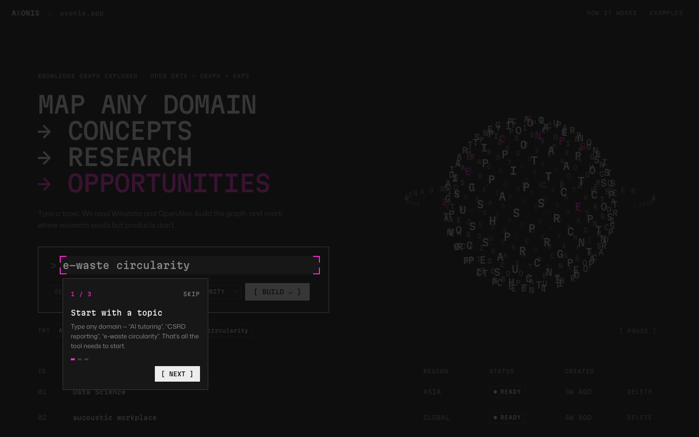
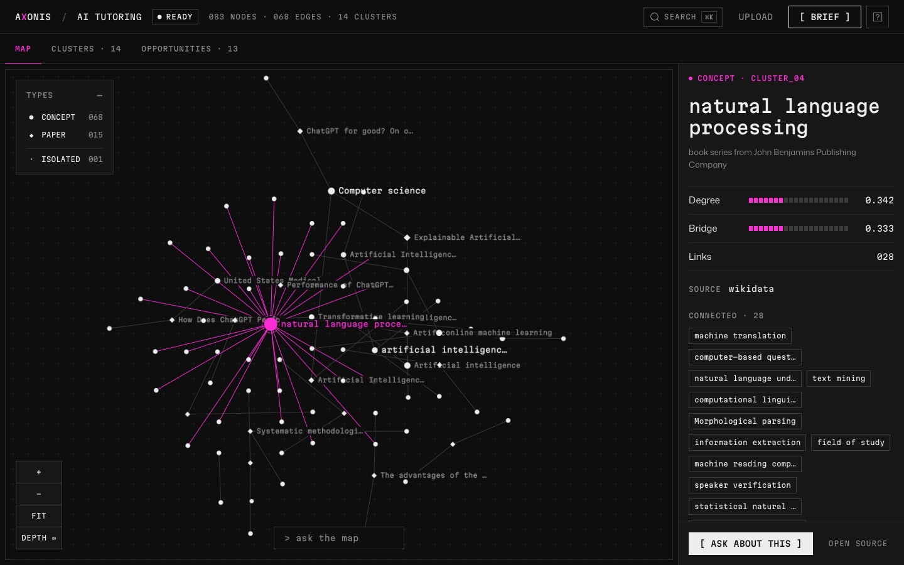
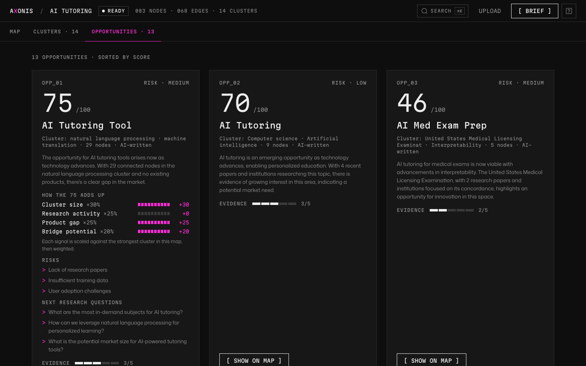

# Axonis

**Map any domain: concepts, research, opportunities.**
Type a topic. Axonis reads Wikidata and OpenAlex, builds a knowledge graph, groups it into clusters, and marks the places where research exists but products don't.

Live at **[axonis.app](https://axonis.app)**.



## What it does

- **Build a map from a topic.** The topic is expanded into search terms. Wikidata supplies concepts and how they relate. OpenAlex supplies relevant, well-cited papers and institutions. Duplicates are merged into one graph. The build screen shows the real pipeline stage and real counts as the server reports them.
- **Explore the graph.** Node shape shows the type. You can:
  - select a node to see its centrality and bridge score;
  - filter by type in the legend;
  - focus on a node's neighbourhood within 1 or 2 hops;
  - jump to any node with **⌘K**.
- **Clusters and opportunities.** Communities (Louvain) are scored on four signals: size, research activity, product gap and bridge potential. Each opportunity card shows how its score adds up, with risks and next questions.
- **Ask the map.** Ask a question and get a short answer grounded in the graph. Inline `[n]` citations link to nodes: hover one to light the node, click it to centre the graph.
- **Research brief.** Export the map as a written brief (Markdown or print).




## Stack

| Layer | Tech |
|---|---|
| Frontend | React 18 + Vite 5, plain CSS (dark-only "B²" design system), Cytoscape.js + cola layout, TanStack Query; self-hosted Martian Mono and Mona Sans |
| Backend | Python 3.12, FastAPI, SQLAlchemy, NetworkX + python-louvain |
| Data | Wikidata (search + SPARQL), OpenAlex (works, concepts, institutions) |
| AI | Groq, Llama 3.3 70B. Used for topic expansion, opportunity copy and Ask. Optional: without a key, template text is used. |
| Storage | SQLite locally, PostgreSQL in production |
| Deploy | One Docker image (FastAPI serves the built SPA) on Coolify, Hetzner |

## Project structure

```
backend/
  main.py            FastAPI app, security headers / CSP, serves frontend/dist in production
  routers/           /api/projects… (create, build, ask, brief, upload) and graph reads
  graph/             builder pipeline, metrics, clustering, opportunity scoring, build progress
  sources/           Wikidata and OpenAlex clients
  ai/                topic expansion, opportunity writer, Q&A, brief
  tests/             pytest (runs on throwaway SQLite, no external AI)
frontend/
  src/pages/         HomePage, ProjectPage
  src/components/    GraphCanvas, GraphLegend, GraphControls, CommandPalette, AskPanel,
                     EntityCard, OpportunityBoard, LetterSphere (hero), states, icons
  src/styles.css     B² tokens and components
docs/design-research/  research, references and the B² implementation spec
Dockerfile           multi-stage: build the SPA, then the Python runtime
```

## Run locally

Backend (port 3001):

```bash
cd backend
python3 -m venv .venv && source .venv/bin/activate
pip install -r requirements.txt
uvicorn main:app --port 3001 --reload
```

Frontend (port 5173, proxies `/api` to 3001):

```bash
cd frontend
npm install --include=dev
npm run dev
```

To point the dev server at another backend, set `API_PROXY_TARGET` (for example a deployed URL).

### Environment

| Variable | Purpose |
|---|---|
| `DATABASE_URL` | Postgres URL. If empty, uses SQLite. |
| `SQLITE_PATH` | Location of the SQLite file (local only) |
| `GROQ_API_KEY` | Enables AI expansion, opportunity copy and Ask. Optional. |
| `OPENALEX_MAILTO` | Contact email for the OpenAlex polite pool |
| `NODE_ENV=production` | Makes the backend serve the built frontend |

## Tests

```bash
cd backend && pytest -q
cd frontend && NODE_ENV=test npm test
```

`NODE_ENV=test` matters if your shell exports `NODE_ENV=production`, because React's test utilities need the development build.

## API

All routes are under `/api`.

| Method | Path | |
|---|---|---|
| `GET` | `/health` | DB check |
| `POST` | `/projects` | Create a project (`topic`, `region`, `goal`) |
| `GET` | `/projects` | List projects |
| `GET` | `/projects/{id}` | Project status; includes `progress` while building |
| `POST` | `/projects/{id}/build` | Start a build (background) |
| `GET` | `/projects/{id}/graph` | Nodes and edges |
| `GET` | `/projects/{id}/entities/{entity_id}` | One entity with its neighbours |
| `GET` | `/projects/{id}/clusters` | Clusters |
| `GET` | `/projects/{id}/opportunities` | Scored opportunities with `score_parts` |
| `POST` | `/projects/{id}/ask` | Grounded answer with numbered `sources` |
| `GET` | `/projects/{id}/brief` | Research brief (Markdown) |
| `POST` | `/projects/{id}/upload` | Enrich the graph from a PDF, CSV, TXT or MD file |
| `DELETE` | `/projects/{id}` | Delete a project |

## Note

This is a portfolio demo with no accounts: every visitor sees and can build maps. Data comes from open sources (Wikidata CC0, OpenAlex CC0).
